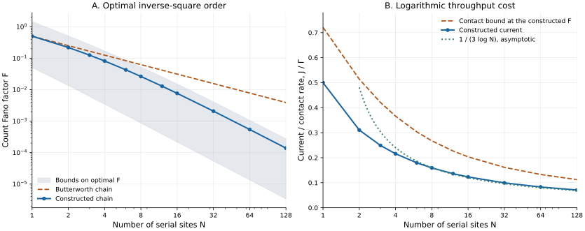

# Quantum Transport Precision

**How quietly can a finite coherent chain transmit particles, and what output rate can it sustain?**

This project studies a noninteracting chain of $`N`$ orbitals between a completely filled source and an empty drain, with energy-independent contacts. The long-time Fano factor $`F`$ measures particle-count variance divided by mean count; $`J`$ is the mean current.

The best possible noise scaling for this serial geometry is

```math
F_N^\star=\Theta(N^{-2}).
```

Every connected chain obeys $`F\geq1/(18N^2+2)`$. An explicit family realizes the matching order with exactly $`N`$ sites, zero onsite energies, mirror-symmetric nearest-neighbor hoppings, and equal contact rates.

Precision also has a throughput cost:

```math
J\,\frac{\log(1/F)}{1-F}
\leq\min(\Gamma_L,\Gamma_R).
```

At a fixed common physical contact rate $`\Gamma`$, the construction achieves

```math
F_N=\Theta(N^{-2}),
\qquad
J_N\sim\frac{\Gamma}{3\log N}.
```

Any chain family attaining the inverse-square noise law at bounded contact rates must pay a logarithmic loss of current. The construction attains that order; the leading constants in the general bounds are not claimed to be optimal.



*Left: the constructed Fano factors, the inherited Butterworth benchmark, and rigorous upper and lower bounds on the optimum. Right: the constructed current at unit contact rate, its current-specific contact bound, and the proved asymptotic behavior. The finite data illustrate the analytical results; they are not a fit used to establish the exponent.*

The Legendre-derivative filter is the classical least-squares family of [Malvar and Calôba (1980)](references/RELATED_WORK.md#malvar1980). Scattering theory, polynomial derivative bounds, and lossless matching theory are also established ingredients. The [related-work account](references/RELATED_WORK.md) identifies what each source supplies and compares the resulting transport statements with earlier quantum-dot filters and correlated clocks.

## Read the science

Start with the [model and exact claims](science/model.md), or use the [scientific reading map](science/README.md).

| Question | Authoritative account |
|---|---|
| Which physical model and counting convention are used? | [Model, observables, and claims](science/model.md) |
| Why can no serial chain beat the inverse-square order? | [Universal size bound](science/size_bound.md) |
| Which filter attains that order, and what is its contact cost? | [Legendre family and asymptotics](science/legendre_family.md) |
| Does the transmission correspond to exactly $`N`$ physical sites? | [Spectral-factor and Jacobi realization](science/realization.md) |
| How do endpoint rates constrain current at a given noise level? | [Contact-rate theorem](science/contact_rate.md) |
| What changes when bandwidth or contact strength is held fixed? | [Physical interpretation](science/interpretation.md) |
| Which results and techniques are inherited? | [Related work](references/RELATED_WORK.md) and [bibliography](references/references.bib) |
| How can the finite checks and figure be reproduced? | [Verification guide](verification/README.md) |

## Reproduce the checks

With Python 3.12, create an environment and install the pinned dependencies:

```bash
python3 -m venv .venv
.venv/bin/python -m pip install -r verification/requirements.txt
.venv/bin/python verification/run_all.py
```

The calculations compare polynomial transmission with explicitly synthesized chains, evaluate the finite bounds and matching area, and independently obtain current and noise from the full fermionic Lindblad generator for small systems. The [verification guide](verification/README.md) gives the commands, recorded outputs, and the scope of each check.

## Scope

$`N`$ counts serial orbitals, while the many-body Hilbert-space dimension is $`2^N`$. The size proof uses the chain's constant transmission numerator. It does not establish the same law for general graphs, structured reservoirs, interactions, finite bias, or nonzero-temperature occupation profiles.

The long-time limit is taken at each finite size. The results do not determine an individual waiting-time variance or a size-uniform transient crossover time. Contact rates are charged explicitly; bounds on hopping amplitudes and control errors are not part of the optimization.

## Purpose and contact

This repository serves as a record of the work and a guide for the author’s self-directed learning. For discussion or potential collaboration, please contact Ruge Lin at [gogoko699@gmail.com](mailto:gogoko699@gmail.com).

