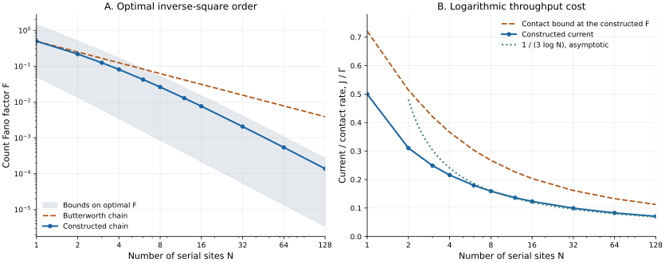

# Quantum Transport Precision

**How quietly can a finite coherent chain transmit particles, and what output rate can it sustain?**

This project studies a noninteracting chain of $`N`$ orbitals between a completely filled source and an empty drain, with energy-independent contacts. The long-time Fano factor $`F`$ measures particle-count variance divided by mean count; $`J`$ is the mean current.

The best possible noise scaling for this serial geometry is

```math
F_N^\star=\Theta(N^{-2}).
```

Every connected chain obeys $`F\geq1/(18N^2+2)`$. An explicit family realizes the matching order with exactly $`N`$ sites, zero onsite energies, mirror-symmetric nearest-neighbor hoppings, and equal contact rates.

Precision also has a throughput cost:

```math
J\,\frac{\log(1/F)}{1-F}
\leq\min(\Gamma_L,\Gamma_R).
```

At a fixed common physical contact rate $`\Gamma`$, a chain with shifted Chebyshev reflection zeros achieves the optimal leading current at inverse-square noise,

```math
F_N=\Theta(N^{-2}),
\qquad
J_N\sim\frac{\Gamma}{2\log N}.
```

This is a 50% increase in leading current over the Legendre construction at the same contact rate and noise exponent. For every vanishing noise ceiling $`f_N`$ with $`f_N\ge C/N^2`$ for a sufficiently large constant $`C`$, the [current frontier](science/fixed_contact_frontier.md) is

```math
J_N^\star(f_N;\Gamma)\sim\frac{\Gamma}{\log(1/f_N)}.
```



*Legendre baseline. Left, finite-size Fano factors alongside the Butterworth benchmark and size bounds. Right, the Legendre current and its contact bound. The shifted-root construction closes the leading-current gap visible in the right panel.*

The Legendre-derivative filter is the classical least-squares family of [Malvar and Calôba (1980)](references/RELATED_WORK.md#malvar1980). Scattering theory, polynomial derivative bounds, and lossless matching theory are also established ingredients. The [related-work account](references/RELATED_WORK.md) identifies what each source supplies and compares the resulting transport statements with earlier quantum-dot filters and correlated clocks.

## Read the science

Start with the [model and exact claims](science/model.md), or use the [scientific reading map](science/README.md).

| Question | Authoritative account |
|---|---|
| Which physical model and counting convention are used? | [Model, observables, and claims](science/model.md) |
| Why can no serial chain beat the inverse-square order? | [Universal size bound](science/size_bound.md) |
| How does the original filter attain the noise order? | [Legendre family and asymptotics](science/legendre_family.md) |
| Does the transmission correspond to exactly $`N`$ physical sites? | [Spectral-factor and Jacobi realization](science/realization.md) |
| How do endpoint rates constrain current at a given noise level? | [Contact-rate theorem](science/contact_rate.md) |
| Which chains attain the leading current at a prescribed noise ceiling? | [Fixed-contact current frontier](science/fixed_contact_frontier.md) |
| What changes when bandwidth or contact strength is held fixed? | [Physical interpretation](science/interpretation.md) |
| Which results and techniques are inherited? | [Related work](references/RELATED_WORK.md) and [bibliography](references/references.bib) |
| How can the finite checks and figure be reproduced? | [Verification guide](verification/README.md) |

## Learn the project

The educational anchor is Supriyo Datta's *Electronic Transport in Mesoscopic Systems* (Cambridge University Press, 1995). Its treatment of transmission, scattering matrices, Green functions, and resonant tunneling provides the physical starting point.

The [learning entrypoint](learning/README.md) connects that starting point to the complete result. The [Datta bridge](learning/DATTA_BRIDGE.md) maps verified chapters to the repository's notation, works through a single resonant level, and supplies the extra steps needed for the polynomial and contact-rate arguments. The [30-milestone map](learning/MILESTONES.md) has 14 background milestones followed by 16 milestones through the research narrative, with explicit dependencies and source pointers.

For a compact guide by reading goal, see [llms.txt](llms.txt).

## Reproduce the checks

With Python 3.12, create an environment and install the pinned dependencies:

```bash
python3 -m venv .venv
.venv/bin/python -m pip install -r verification/requirements.txt
.venv/bin/python verification/run_all.py
```

The calculations compare polynomial transmission with explicitly synthesized chains, evaluate the full-line current, noise and matching area, and independently obtain current and noise from the full fermionic Lindblad generator for small systems. The [verification guide](verification/README.md) gives the commands, recorded outputs, and the scope of each check.

## Scope

$`N`$ counts serial orbitals, while the many-body Hilbert-space dimension is $`2^N`$. The size proof uses the chain's constant transmission numerator. It does not establish the same law for general graphs, structured reservoirs, interactions, finite bias, or nonzero-temperature occupation profiles.

The long-time limit is taken at each finite size. The results do not determine an individual waiting-time variance or a size-uniform transient crossover time. Contact rates are charged explicitly; bounds on hopping amplitudes and control errors are not part of the optimization.

## Purpose and contact

This repository serves as a record of the work and a guide for the author’s self-directed learning. For discussion or potential collaboration, please contact Ruge Lin at [gogoko699@gmail.com](mailto:gogoko699@gmail.com).

